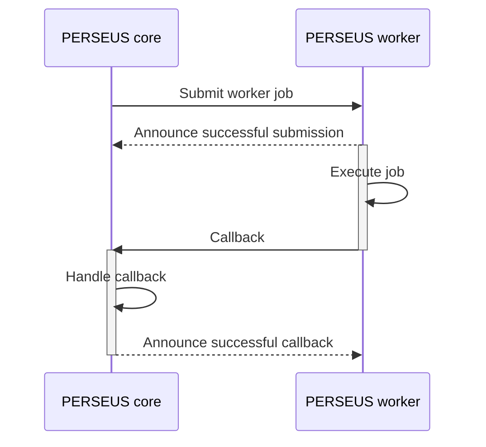

# PERSEUS Worker

PERSEUS workers can be used to outsource specific tasks outside PERSEUS core.

Examples:
* Initializing a new compute project on your cluster, where you need to trigger scripts on a specific machine
* Very time-consuming tasks, which should not block a process within PERSEUS core

## Functionality

A PERSEUS core instance can submit jobs to a PERSEUS worker.
Please note that the logic required for a job has to be added to the worker and is not sent between the components.
Basically, PERSEUS core announces that a job has to be done (data can be added).
The worker will execute the job and tell PERSEUS core that the job has finished by using a callback given when the job was submitted in the first place.



## Run worker

To run the PERSEUS worker follow these steps:
1. Install python (tested on python 3.12)
2. Install [uv](https://docs.astral.sh/uv/) and sync dependencies:
```shell
uv sync
```
3. [Add PERSEUS instance to whitelist](#add-perseus-instance-to-whitelist)
4. [Add the worker's logic](#add-worker-logic)
5. Run from the main directory:
```shell
uv run fastapi run main.py
```

For more information on running the webserver take a look at [the fastapi documentation](https://fastapi.tiangolo.com/deployment/manually/).

## Add PERSEUS instance to whitelist

To allow a certain PERSEUS instance to submit jobs to the worker, you must add it to the whitelist.
To do so, create a file `whitelist.txt` and add the URL of the PERSEUS core instance (one per line).
Please be reminded to add the complete URL to the core instance, i.e. `https://core.perseus.my-institution.com/api`.

## Add worker logic

To allow the worker to actually work on jobs, you can add so-called handlers. You can add as many handlers as you like.
Each handler should accept only one type of jobs.

To add a handler, you can either use an already existing handler from the
[publicly available plugins](https://github.com/pc2-perseus/perseus-plugins) or create a new one.

### Add already existing handler

Let's say you have a new worker and downloaded a handler called `ExecuteSlurmMagic.py`.
You only need to move the file to the `handlers` directory. Your file structure should look like this:

```

|-- handlers
|   |-- __init__.py
|   |-- BaseHandler.py
|   |-- EchoHandler.py
|   |-- ExecuteSlurmMagic.py

```

In case the handler is not only a file but a package, it works the same way:

```

|-- handlers
|   |-- __init__.py
|   |-- BaseHandler.py
|   |-- EchoHandler.py
|   |-- slurm_handler_package

```

Done! Your handler is now ready to use.


### Create a new handler

Let's say we want to implement a handler called `MyAwesomeHandler`.
First, we would need to create the file `handlers/MyAwesomeHandler.py`.

Then, we need to create a new class called `MyAwesomeHandler` which inherits from `BaseHandler`,
add an attribute `path` and implement the asynchronous classmethod `handle_request`:

```python
from typing import Any
from .BaseHandler import BaseHandler


class MyAwesomeHandler(BaseHandler):
    path: str = "my-path"

    @classmethod
    async def handle_request(cls, payload: dict[str, Any], dev_mode: bool = False) -> dict[str, Any]:
        ...
```

The `path` attribute defines to which path the handler should listen to when a new job will be submitted.
A handler can only listen to one path.

Add your handler's logic to the `handle_request` method.
The parameter `payload` is the payload given by PERSEUS core when submitting a job.
This can be used to transfer data that is necessary to execute the job.
To handle tasks differently when the worker runs in development mode, you can make use of the `dev_mode` parameter.

## Bigger handler codebases

In case you have multiple files which the handler imports, you maybe want to structure your code in a directory.
To do so, create a new directory and handle it as a python package, meaning you need to add a `__init__.py` at top-level
and import your handler there. An example could look like this:

```

|-- handlers
|   |-- __init__.py
|   |-- BaseHandler.py
|   |-- EchoHandler.py
|   |-- my_handler
|   |   |-- __init__.py
|   |   |-- MyAwesomeHandler.py
|   |   |-- helper1.py
|   |   |-- helper2.py

```

The `__init__.py` would look like this:

```python
from .MyAwesomeHandler import MyAwesomeHandler
# you can add more imports, this is the required minimum 
```

## Submit job to worker

In your custom state or service within PERSEUS core, import the following:

```python
from perseus.utils.submit_worker_job import submit_worker_job
```

Then, call it like this:

```python
job_id = submit_worker_job(
    worker_url="https://my.perseus.worker/path",  # where to access the worker, including the path so the worker knows which handler to use
    payload={"my": "data"},  # any data you want to submit with the job, has to be dict
    callback_url="https://core.perseus.my-institution.com/api/service/MyService/callback",  # what URL the worker should request as callback, usually a service
    worker_timeout=600,  # seconds until the job will be terminated (default is 3600)
    request_timeout=10,  # seconds until the request towards the worker will time out (default is 5)
)  # returns either the assigned job_id (str) or None in case there was an error

```

## Run worker in development mode

To run the worker in development mode to test its functionality, start it as follows:

```shell
DEV_MODE=1 uv run fastapi run main.py
```

This deactivates all security mechanisms and allows you to send jobs yourself using HTTP requests.

To run a test, your HTTP request should look like this:

- HTTP method: `POST`
- URL: `http://localhost:8000/<PATH>` (change the port if you started fastapi with a different port)
- Body: JSON string with following keys:
  - payload: A JSON object, used as payload for the job
  - timeout: A number, indicating how long the worker should run the job before it will be terminated (in seconds)

An example to test the echo handler with curl could look like this:

```bash

curl --location 'localhost:8000/echo' \
--header 'Content-Type: application/json' \
--data '{"payload": {"my": "data"}, "timeout": 10}'

```
