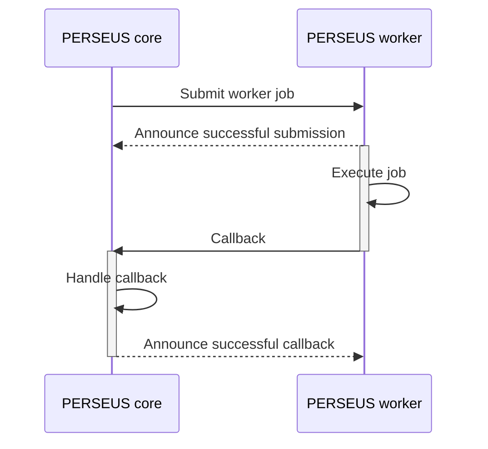

# PERSEUS Worker

PERSEUS workers can be used to outsource specific tasks outside PERSEUS core.

Examples:
* Initializing a new compute project on your cluster, where you need to trigger scripts on a specific machine
* Very time-consuming tasks, which should not block a process within PERSEUS core

## Functionality

A PERSEUS core instance can submit jobs to a PERSEUS worker.
Please note that the logic required for a job has to be added to the worker and is not sent between the components.
Basically, PERSEUS core announces that a job has to be done (data can be added).
The worker will execute the job and tell PERSEUS core that the job has finished by using a callback given when the job was submitted in the first place.



## Run worker

To run the PERSEUS worker follow these steps:
1. Install python (tested on python 3.12)
2. Install all the requirements from the requirements.txt
3. [Add the worker's logic](#add-worker-logic)
4. Run from the main directory:
```shell
fastapi run main.py
```

For more information on running the webserver take a look at [the fastapi documentation](https://fastapi.tiangolo.com/deployment/manually/).

## Add worker logic

To allow the worker to actually work on jobs, you can modify the file `handlers/handle_request.py`.
You will find a function called `handle_request`, where you get the following parameters to work with:
* path (str): The path called when submitting a job. This can be used to allow for different jobs to be submitted.
* payload (dict[str, Any]): The payload given by PERSEUS core when submitting a job. This can be used to transfer data that is necessary to execute the job.

## Submit job to worker

In your custom state or service within PERSEUS core, import the following:

```python
from perseus.utils import submit_worker_job
```

Then, call it like this:

```python
job_id = submit_worker_job(
    worker_url="https://my.perseus.worker/path",  # where to access the worker
    payload={"my": "data"},  # any data you want to submit with the job, has to be dict
    callback_url="https://core.perseus.my-institution.com/api/service/MyService/callback"  # what URL the worker should request as callback, usually a service
    timeout=600,  # seconds until the job will be terminated (default is 3600)
)  # returns either the assigned job_id (str) or None in case there was an error

```